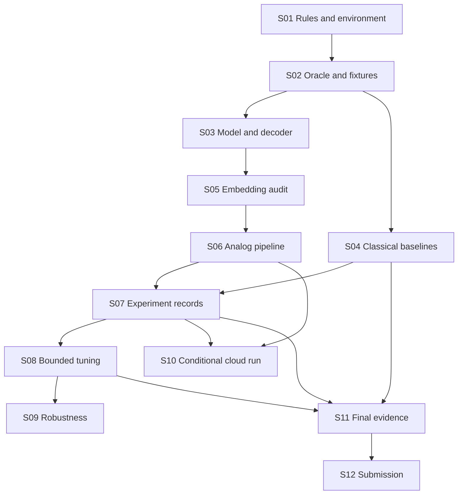

# DuQuantum PASQAL Track: Mega Plan

**Planning baseline:** October 24, 2026, America/New_York.  
**Target repository:** [ericmao2007/DuQuantum-Pasqal](https://github.com/ericmao2007/DuQuantum-Pasqal).  
**Status:** proposed execution roadmap; no application, deadline, judging rubric, or hardware requirement is assumed confirmed.  
**Goal:** deliver a reproducible, hardware-aware optimization solution with a correct mathematical model, credible classical comparisons, a measured PASQAL analog pipeline, and a clear final demonstration.

## 1. Start here

Build the smallest trustworthy end-to-end solver before expanding the problem or tuning pulses. A successful submission connects the actual challenge objective to binary decisions, an atom register, valid pulses, measured bitstrings, and independently checked application solutions.

The first useful result is a tiny instance for which we can prove the optimum, explain every model term, execute a local analog sequence, and compare decoded samples against the same classical objective. The strongest final story is evidence of what each stage contributes, including failure modes and the cost of classical preprocessing and repair.

**First 90 minutes after the actual challenge briefing:**

- [ ] Save the official statement, dataset version, scoring rules, submission format, deadline/timezone, and hardware policy in `docs/challenge_contract.md`.
- [ ] Assign a named owner and backup to modeling, analog execution, benchmarking, and integration/demo. These are proposed roles, not staffing commitments.
- [ ] Reproduce the team tutorials in an isolated environment using the team's dependency files.
- [ ] Hand-solve a tiny challenge instance and implement its independent feasibility/objective checker.
- [ ] Select the simplest valid analog mapping and decide the maximum variable count, including slack and auxiliary bits.
- [ ] Freeze a minimum viable submission and the first experiment budget before attempting improvements.

If fewer than six hours remain, execute the emergency route in Section 11 and omit optional architecture work.

## 2. What exists and what remains unknown

### Verified project baseline

The team repository was inspected in the signed-in GitHub browser at `main`, commit `13c47ac339c635f5ee1839563d7f9ccf410157eb`. It contains dependency files, two tutorial scripts with documentation, and generated outputs:

- `examples/pulser_tutorial.py` and `examples/README.md`: single-atom excitation and nine-atom checkerboard state preparation.
- `examples/register_interactions.py` and `examples/REGISTER_INTERACTIONS.md`: register geometry, inverse-sixth-power interactions, blockade interpretation, and a two-atom distance experiment.
- `output/pulser_tutorial/` and `output/register_interactions/`: tutorial artifacts.
- `requirements.txt` and `requirements.lock.txt`: the team environment baseline.

The current top-level pins were checked: Pulser 1.9.1, QoolQit 1.5.0, QUBO Solver 0.9.1, EMU-SV/MPS 2.10.0, and Pasqal Cloud SDK 0.24.0. The complete lockfile was not audited during planning; S01 verifies installation rather than assuming it is portable.

These are introductory local demonstrations. They do not establish a challenge-specific solver, benchmark result, hardware run, or quantum advantage. The nine-atom tutorial's stored 129/1000 target count is one sampled state-preparation result, not a challenge score. Existing remote examples were reviewed, not rerun while preparing this plan.

A separate preparation workspace has executed the official unitaryCON notebooks and recorded successful local checks. Its older dependency pins differ from the team repository. Do not copy that environment or its import paths into the team project without a compatibility check.

### Planning assumptions and required decisions

The supplied six-page PASQAL pre-reading explicitly says the challenge will be revealed at the hackathon. It does not establish the final problem, dataset, rubric, deadline, permitted approximation, or required QPU usage. An insurance optimization retrospective is background material, not our selected problem or challenge specification.

| Unknown | Record the answer in | Consequence if unresolved |
| --- | --- | --- |
| Objective direction, units, and tie breaking | `docs/challenge_contract.md` | No meaningful score comparison |
| Hard constraints, tolerances, and infeasibility policy | Same contract and checker | Cannot certify a valid solution |
| Input sizes, graph structure, coefficient ranges | Dataset manifest | Cannot choose representation or backend |
| Required PASQAL tools and hardware evidence | Challenge contract | Local emulation may not meet submission rules |
| QPU/emulator project access, quotas, prices, queue limits | Private run configuration; public summary without secrets | Plan a local route while access is resolved |
| Deadline/timezone, pitch length, deliverable format | Challenge contract | Use relative schedule until confirmed |
| Team members and availability | `docs/ownership.md` | One person can hold multiple roles |

Gate G0 closes only when the challenge contract is written. Preparation and reusable evaluators may proceed before G0; application-specific choices remain provisional.

## 3. Scope and decision strategy

### Minimum viable submission

1. One challenge-aligned problem family and a small, documented instance suite.
2. A model with variable definitions, objective units, full constraints, and a validated decoder.
3. An exact tiny-instance oracle plus random and practical heuristic baselines.
4. One end-to-end PASQAL analog route on a local backend, with serialized configuration and raw counts.
5. A comparison of feasibility, original objective, cost/energy, runtime, and resource use.
6. A runnable demonstration, results table, limitations, and submission checklist.

Hardware execution becomes part of the minimum if the official rules require it. An emulator result cannot replace that requirement. If access is missing, escalate it to the organizers/team early and document the unmet requirement.

### Select a model that fits the machine

| Actual problem structure | First route to investigate | Main acceptance test |
| --- | --- | --- |
| Geometric exclusion or independent-set problem | MIS/MWIS-style register and detuning model | Correct objective, realizable geometry, available weighting controls |
| Small QUBO compatible with the selected embedding method | QUBO Solver baseline, then inspect embedding/drive | Original-model and embedded-model solutions agree sufficiently |
| Dense, signed, or highly constrained binary program | Classical preprocessing and small residual subproblems | Every transformation is decoded and validated; residual mapping is credible |
| Rules specify a different problem or method | Follow the official task and reassess this table | A written mapping to the scoring requirements |

Prefer one supported solver route over building three complete frameworks. QUBO Solver is a candidate fast baseline; QoolQit is useful when compilation/embedding control is needed; Pulser provides pulse-level inspection and customization. Check the APIs against the installed team versions before coding. These choices follow the tools' documented roles, not a promise that arbitrary QUBOs are physically representable. [S2-S4]

Optional work starts only after the minimum path passes: pulse search, robust/noisy emulation, decomposition, multiple embeddings, and a small verified cloud run. A custom interface, new cloud service, gate-model QAOA, full DQI implementation, and an unbounded library upgrade are outside the initial scope.

## 4. Mathematical and physical contract

### Keep the original objective authoritative

For a minimization formulation, define a canonical polynomial:

```text
E(x) = c + sum_i a_i*x_i + sum_{i<j} b_ij*x_i*x_j,  x_i in {0,1}
```

For a symmetric matrix interface using `x.T @ Q @ x`, set `Q_ii = a_i` and `Q_ij = Q_ji = b_ij/2`. Store `c` separately. An upper-triangular representation uses a different off-diagonal convention; test each library boundary. QUBO Solver documents a symmetric matrix convention. [S4]

For a maximization task, record the exact sign conversion and convert results back to the original score. Preserve any scaling and constant offsets in metadata. Use asymmetric hand-worked fixtures to catch bit-order errors: the register's `qubit_ids` order is explicit and must survive serialization and decoding.

For each constraint, record its original form, encoding, penalty, slack bound, auxiliary bits, and decoder. As a simple example, `sum_i x_i = k` may use `lambda*(sum_i x_i-k)^2`. Inequalities need a justified bounded encoding or another valid reduction. Count every slack/auxiliary bit before choosing simulation size. Prove or exhaustively check penalty sufficiency on tiny instances; a large penalty can damage physical coefficient resolution even when it enforces feasibility mathematically.

The authoritative checker evaluates the original constraints and original objective, independently of penalized QUBO energy. Report raw and repaired samples separately. A repaired answer is a hybrid result, and repair runtime belongs in the total.

### Match the target to an accessible analog Hamiltonian

For the real-drive, repulsive Rydberg model considered here:

```text
H(t)/hbar = sum_i [Omega_i(t)*sigma_x_i/2 - delta_i(t)*n_i]
            + sum_{i<j} [C6/hbar / r_ij^6]*n_i*n_j
```

The selected device determines available controls. A global Rydberg channel does not imply arbitrary per-atom drive or detuning. Positive distance-based pair interactions, Euclidean geometry, minimum spacing, register extent, supported layouts, timing granularity, amplitude/detuning bounds, and modulation constraints restrict the target model. Blockade graph edges are an approximation; non-edge pairs still interact. [S5]

Use micrometers for register coordinates, nanoseconds for Pulser pulse durations, and rad/microsecond for drive, detuning, and interaction angular frequencies; record every conversion. In the formula, `C6` is an energy-times-length-to-the-sixth coefficient. If the library instead exposes `device.interaction_coeff` already equal to `C6/hbar` in angular-frequency units times micrometers to the sixth, use `U_ij = device.interaction_coeff/r_ij**6` directly; do not divide by hbar again. For a positive scale `s` converting canonical cost units to angular frequency, an exact diagonal match would require `-delta_i(T) = s*a_i` and `U_ij = s*b_ij`, up to an irrelevant constant. These equalities are targets, not guaranteed accessible controls. Compare target energies with the final diagonal cost at `Omega(T)=0`; if the drive remains nonzero, label the comparison as diagonal-component evidence and do not equate full-Hamiltonian ground states with classical optima.

For each embedding, save target coefficients, actual pair interactions, fitted positive energy scale, reachable diagonal terms, residual/error metric, atom coordinates and ordering, device identity/version, control assumptions, and sequence duration. Validate the actual final embedded energies against the target on tiny instances, including ranking of feasible solutions and degeneracy. A small matrix residual alone is insufficient if it changes the optimizer.

Use the real target device constraints for hardware-bound work. Passing on a virtual or permissive device is development evidence only. Reject, transform, decompose, or explicitly label unsupported mappings; do not silently drop negative couplings, weak long-range terms, or unavailable local controls.

## 5. Proposed implementation layout and contracts

The following paths are planned deliverables, not files that already exist. Keep existing tutorials and their outputs as reference examples.

```text
plans/DUQUANTUM_PASQAL_MEGA_PLAN.md
pyproject.toml
docs/challenge_contract.md, formulation.md, ownership.md, experiment_protocol.md
src/duquantum/{instances,model,decode,validate,baselines,embedding,pulses,backends,experiments,report}.py
configs/{smoke,baseline,sweep,cloud}.json
data/{tiny,development,holdout}/
tests/{test_model,test_decode,test_embedding,test_pipeline}.py
output/experiments/<run_id>/{manifest.json,counts.json,metrics.json,...}
reports/{results.csv,summary.md,figures/}
demo.py
```

Use a small importable package only when it reduces duplication; the emergency route can use fewer modules. Favor standard-library `unittest` and JSON initially so the first correctness checks do not require another testing dependency.

Core contracts:

- **Instance:** stable ID/hash, source/license, objective direction/units, ordered variables, constraints, and input data.
- **Model:** instance ID, canonical coefficients, offset, penalty/slack metadata, variable-index map, and conversion version.
- **Embedding:** coordinates, register order, device/control identifiers, target/realized terms, scale, residual, and validity report.
- **Run:** source commit, dependency fingerprint, config hash, seeds, backend/device, requested/observed shots, timing breakdown, status, and artifact paths.
- **Candidate:** raw bitstring, decoded application decisions, original feasibility/violations, original objective, QUBO energy, count, and optional repaired counterpart.

All backends return counts through the same adapter contract. A failure returns an explicit status and diagnostic; it never masquerades as a successful empty result. Keep credentials in environment variables or a private credential mechanism, outside committed artifacts. Cloud configuration contains placeholders/project references only where safe, never secrets.

## 6. Twelve reviewable implementation steps

Each step is sized for one focused PR or a comparable reviewed commit. Use proposed branch names `pasqal/s01-contract` through `pasqal/s12-submission`. The current document is a plan only; the steps below are not implemented by publishing it. Runtime estimates are working budgets, not event commitments.

Verification commands below are **acceptance commands to implement**, except the two existing tutorial commands. Later steps must add their CLI options and fixtures before relying on them. `PY` means the interpreter in a clean team-repository environment, not the separate preparation environment.

### S01. Freeze rules and reproduce the team baseline

**Context / dependencies:** start from the team repository and actual challenge briefing; no dependency on later steps. Owner: integration lead. Budget: 30-60 minutes. Reasoning tier: default.

Tasks: write the challenge contract and owner table; inventory current dependencies; create a clean environment; run both existing scripts; record versions, durations, output paths, and whether access permits cloud execution. Preserve the existing dependency pins until a specific compatibility failure justifies a change.

Verification:

```sh
python3.12 -m venv .venv
.venv/bin/python -m pip install -r requirements.lock.txt
.venv/bin/python -m pip check
.venv/bin/python examples/pulser_tutorial.py
.venv/bin/python examples/register_interactions.py
```

**Exit / G0:** documented rules and named owners; reproducible local examples or a concrete compatibility issue with a tested fix. **Rollback:** retain existing dependency files and tutorial artifacts; isolate any upgrade in a separate environment.

### S02. Build the original-problem oracle and fixture suite

**Context / dependencies:** S01 supplies authoritative constraints and objective. Owner: modeling lead. Budget: 60-90 minutes. Reasoning tier: strongest available for interpreting ambiguous constraints.

Tasks: create `pyproject.toml` with the `src` package configuration, `src/duquantum/__init__.py`, and the initial importable modules; then create tiny hand-solvable instances, boundary/infeasible/degenerate cases, stable variable order, independent scorer, and feasibility checker; enumerate tiny decision spaces for exact optima. Freeze fixtures before optimizing the analog route. Choose an exact enumeration cap from measured runtime; never make exhaustive search the large-instance baseline.

Verification: install the project with `PY -m pip install -e . --no-deps`, verify `PY -c 'import duquantum'`, then run `PY -m unittest discover -s tests -p 'test_model.py'`; independently reconcile every tiny optimum with a manual example. Keep runtime dependencies in the established environment files or synchronize any package metadata declarations. **Exit:** the package imports in the clean environment, the checker rejects known violations and agrees with hand calculations, including maximization/minimization and ties. **Rollback:** return to fixtures and correct the contract before continuing.

### S03. Encode and audit QUBO or the native graph model

**Context / dependencies:** S02 defines authoritative scoring and fixtures. Owner: modeling lead. Budget: 60-120 minutes. Reasoning tier: strongest available.

Tasks: document decisions/auxiliaries, derive coefficients, preserve offsets and scaling, implement polynomial/matrix conversion and decoder, justify penalties, and count physical variables. For a native MIS/MWIS route, document why the native cost represents the challenge instead of forcing unnecessary generic QUBO machinery.

Verification: enumerate all assignments of small encoded fixtures, including auxiliary bits; compare polynomial, matrix, and decoded costs; test bit-order round trips and penalty sufficiency with `PY -m unittest discover -s tests -p 'test_model.py'` and `... -p 'test_decode.py'`.

**Exit / G1:** tiny encoded optima decode to original feasible optima, no coefficient-convention mismatch, resource count fits the initial budget. **Rollback:** simplify constraints, tighten slack bounds, or choose another valid representation before analog work.

### S04. Establish classical baselines

**Context / dependencies:** S02 is sufficient; can proceed alongside S03 after scoring/fixtures are frozen. Owner: benchmark lead. Budget: 45-90 minutes. Reasoning tier: default.

Tasks: implement seeded random sampling and an appropriate greedy/local-search heuristic; retain exact enumeration on tiny instances; use an available exact optimization solver for larger instances only if time/dependencies allow. Return results in the shared candidate/run schema. Publish time limits and timeout/bound status.

Verification: `PY -m duquantum.experiments --config configs/baseline.json`; exact results agree with fixtures; every baseline answer passes the same independent checker. **Exit:** checked reference table with seeds, budgets, runtimes, and known optima/bounds. **Rollback:** keep exact tiny plus random/greedy routes if an optional external solver fails.

### S05. Add a device-valid embedding and mapping audit

**Context / dependencies:** S03 fixes model conventions; use the existing register example as a starting reference, not a generic optimizer. Owner: analog lead. Budget: 90-150 minutes. Reasoning tier: strongest available.

Tasks: select the actual device/control set; try the simplest supported embedding; record coefficient/geometry restrictions; evaluate long-range interactions and final-energy rankings; quantify auxiliary overhead. Fail clearly on unsupported signs, weights, or sizes. Support a declared approximate mode only if the challenge permits it and report its distortion.

Verification: `PY -m unittest discover -s tests -p 'test_embedding.py'`; translation/order fixtures, device validation, deliberate invalid-register case, target versus embedded tiny optima. **Exit / G2:** one valid small mapping with acceptable optimizer agreement and explicit control assumptions. **Rollback:** shrink instance, preprocess/decompose, change valid formulation, or use a native geometric case if allowed.

### S06. Produce the first analog end-to-end result

**Context / dependencies:** S05 supplies valid geometry and S03 supplies the decoder. Owner: analog lead. Budget: 60-120 minutes. Reasoning tier: default.

Tasks: create one conservative parameterized pulse/drive; run the smallest model on the selected local backend; persist register/sequence/config/raw counts; decode and score every sampled candidate; use QUBO Solver as the initial route if it fits and inspect its outputs rather than treating it as a black box.

Verification: `PY -m duquantum.experiments --config configs/smoke.json`; validate sequence, counts/shots, bit order, feasibility, and cost; confirm intentionally malformed input fails without losing diagnostics. **Exit / G3:** an auditable chain from challenge instance to original objective and counts. An optimum hit is a measured outcome, not a completion requirement unless the task demands it. **Rollback:** return to the last passing tiny model and simple pulse; preserve failures for diagnosis.

### S07. Integrate experiment records and reporting

**Context / dependencies:** S04 and S06 define real baseline/analog outputs. Owner: benchmark lead. Budget: 45-90 minutes. Reasoning tier: default.

Tasks: enforce the run schema; create immutable run directories, config/source hashes, resumable manifests, incremental saves, one results CSV, and plots of original objective/feasibility/runtime. Keep infeasible and failed runs visible. Make reports regenerate from raw records.

Verification: `PY -m unittest discover -s tests -p 'test_pipeline.py'`; `PY -m duquantum.report --runs output/experiments --out reports`; replay one run and reconstruct its metrics. **Exit:** all displayed values trace to archived data; missing results are labeled, never replaced with zeros. **Rollback:** a plain JSON/CSV report remains sufficient.

### S08. Tune embedding and pulses under a fixed budget

**Context / dependencies:** S07 supplies reliable metrics and S06 a working route. Owner: analog lead with benchmark lead. Budget: 60-120 minutes, hard-capped. Reasoning tier: strongest available for diagnosing physical mismatch, default for sweeps.

Tasks: vary a small parameter set: total duration, sweep endpoints/shape, peak drive, embedding seed/scale, and penalty only when required; keep all values device-valid. Use development instances and fixed seeds; select settings before opening holdout results. Save every trial, including unsuccessful ones.

Verification: `PY -m duquantum.experiments --config configs/sweep.json`; compare against the frozen default under the same total budget. **Exit:** a reproducible chosen configuration with a complete search-cost ledger, or a documented decision to retain the baseline. **Rollback:** revert to S06's passing configuration; do not spend the demo buffer chasing improvement.

### S09. Measure robustness and emulator limits

**Context / dependencies:** S07 and frozen S08 settings; the harness can be prepared earlier. Owner: benchmark lead. Budget: 60-90 minutes. Reasoning tier: default.

Tasks: add supported noise/parameter perturbations; compare backends on tiny cases using distributions rather than identical random counts; increase size only after runtime/memory checks. For MPS, record bond/truncation settings and convergence evidence against a small exact state-vector case. Report noiseless, noisy emulation, and hardware results as distinct categories.

Verification: replay selected tiny fixtures across available compatible backends; halve numerical tolerance or tighten MPS settings on a diagnostic case; compare metric stability against statistical uncertainty. **Exit:** measured limits and at least one robustness result, with approximation parameters. **Rollback:** cap problem size and retain only the validated local backend.

### S10. Execute a small cloud/QPU validation if available or required

**Context / dependencies:** G0 hardware policy, S06 valid serialized program, S07 reporting, and separately provisioned access/quota. Owner: cloud operator. Budget: 30-60 minutes active work plus external queue time. Reasoning tier: default.

Tasks: fetch current target capabilities through supported tools; confirm the permitted project, backend, shots and credit cap; validate compilation; submit one tiny job; save its job ID, target, timestamps/status, counts and decoding report; reuse job IDs on resume. Submit additional jobs only within the declared budget. Never automatically resubmit a timed-out request whose submission status is unknown.

Verification: locally validate the exact payload before submission; retrieve the actual completed result and score it through the same evaluator. **Exit / G4:** a traceable completed remote run, or explicit blocked/failed/skipped status. If hardware is mandatory, skipped/blocked leaves the submission incomplete. **Rollback:** preserve emulator evidence and explain access/queue limits; no invented hardware claims. This plan authorizes no paid jobs by itself.

### S11. Freeze the benchmark and write the evidence

**Context / dependencies:** S04, S07 and chosen settings; include S09/S10 only if executed. Owner: benchmark lead and integration lead. Budget: 60-90 minutes. Reasoning tier: strongest available for interpreting claims.

Tasks: run holdouts once under the frozen protocol, report every instance/run, distinguish target objective from embedded energy, include raw/repaired ablations, and summarize wall-clock breakdown and scaling. State where classical methods win. Produce objective-versus-budget, feasibility, embedding distortion, and resource tables as supported by actual data.

Verification: `PY -m duquantum.report --runs output/experiments --out reports`; independently spot-check one row from counts to application score; ensure timeout, infeasible and no-feasible-sample cases remain visible. **Exit / G5:** defensible results and limitations with no unsupported speedup or advantage claim. **Rollback:** publish a smaller complete benchmark instead of an incomplete broad one.

### S12. Package the demonstration and submission

**Context / dependencies:** G3 and S11; G4 if mandated. Owner: integration/demo lead. Budget: final 60-90 minutes, protected. Reasoning tier: default.

Tasks: create root README with exact environment and editable-package install/run commands; add a small seeded smoke demo with invariant checks and a labeled saved-run replay; prepare slides or a short write-up as required; include inputs/config, commit/version provenance, results, limitations and acknowledgments; check licenses and organizer data rules; rehearse offline; freeze the submission commit. Exact random counts need not be identical across environments; saved-run replay provides the deterministic presentation route.

Verification: a teammate follows only the root README in a clean directory, runs `PY demo.py --config configs/smoke.json`, and regenerates the report; confirm required files/links and deadline. **Exit / G6:** runnable submission at a known commit plus rehearsed explanation, or a precise list of unmet official requirements. **Rollback:** use the last fully verified commit and saved-run replay, clearly labeled as recorded evidence.

## 7. Dependencies and practical parallel work



S09 and S10 feed S11 if performed. S10 also gates S12 when hardware is required. These conditional edges are policy requirements even though the main graph shows the minimum local path.

After S02, S03 and S04 may run concurrently with separate module ownership. After S07, S10 may run while S08 proceeds, but changing the payload requires a new compilation check and provenance record. Demo narrative and README drafting can start early; final numbers and commands freeze after S11. Shared schema changes and dependency-file edits go through one integration owner. With one person, execute the same dependencies serially and cut optional steps.

## 8. Benchmark protocol and evidence standards

### Instance design and budgets

Start with 4-8 tiny cases, including boundary/degenerate/infeasible cases where meaningful, and approximately 6-12 development/holdout cases if the challenge supplies enough instances. Suggested size ladder: 4, 8, 12, then 16 physical bits. These are experiment starting points, not guaranteed simulator capacity. Memory/time gates and actual data structure determine whether to proceed; dense state-vector memory grows exponentially and mixed-state noise can be substantially more expensive.

Suggested initial cap: 20 configurations across two development instances and three seeds at 500 shots, at most 60,000 requested measurement samples. This is up to 120 circuit/sequence evaluations; shots alone do not estimate simulation runtime. Stop sooner on the declared wall-clock/memory limit. Freeze parameters, then evaluate holdouts with a prespecified number of seeds and shots. A practical initial target is five seeds at 1,000 shots per selected instance if the measured budget permits. No cloud cost is implied by these local planning caps.

Use fixed development and holdout membership before tuning. If only one organizer instance exists, disclose that there is no instance holdout; use fixed validation seeds and report the limitation. Never use holdout scores to choose the final parameters while still calling them held out.

### Required metrics

| Metric | Definition / handling |
| --- | --- |
| Original objective | Best/median feasible application score with units and direction |
| Raw feasibility | Feasible raw shots / all valid observed shots; report missing/malformed samples separately |
| Repaired feasibility | Same measure after a documented repair, with raw result retained |
| Optimal hit probability | Shots decoding to any true optimum / valid shots; only when optimum is certified |
| Objective gap | For minimization, best feasible value minus certified optimum/bound; reverse for maximization |
| Normalized gap | Absolute-direction gap / max(1, abs(reference)); label bound-based values explicitly |
| Runtime | Load/model, embedding, tuning, compilation, simulation/execution, queue, decoding/repair, total |
| Resource use | Decision/slack/auxiliary bits, atoms, shots, duration, peak memory, relevant emulator settings |
| Mapping fidelity | Coefficient residual plus tiny-instance optimizer/ranking agreement |
| Run outcome | Success, infeasible, no feasible sample, timeout, invalid mapping, backend failure, blocked access |

Report best-feasible score as unavailable when no feasible candidate exists. A constant energy offset or negative optimum must not create a misleading approximation ratio. If the exact solver times out, retain its bound/status and do not call its incumbent the known optimum.

Show uncertainty across independent seeds/runs. A binomial interval for optimum-hit frequency is a useful within-run summary only under the applicable independence assumption; it does not measure variability from embedding, tuning, or backend drift. Preserve distributions/counts rather than just the winning sample.

For independent repeated trials with measured success probability `0 < p < 1`, the estimated trials to 99% success are `ceil(log(0.01)/log(1-p))`. State whether one trial means one shot or one batch, include its actual cost, and do not treat correlated shots as independent. If `p=0`, no finite empirical estimate is established; if `p=1` in a finite sample, report sample uncertainty instead of certainty.

### Minimum ablations

1. Exact tiny/random/greedy versus analog under declared budgets.
2. Default analog configuration versus tuned configuration, including tuning cost.
3. Raw analog versus analog plus repair, and matched classical postprocessing where meaningful.
4. Target objective versus realized embedded final energy on tiny cases.
5. Optional noiseless versus noisy versus hardware, each clearly labeled.

An emulator executes quantum dynamics on classical hardware. Better sample quality on a small example does not establish computational advantage. Report end-to-end performance and the limits of the comparison.

## 9. Suggested 24-hour execution schedule

All times are elapsed from the **confirmed challenge start**, not a claim about the event's actual schedule. Replace them with real deadlines in the challenge contract. A four-person team is a planning assumption; combine roles if needed.

| Elapsed window | Modeling | Analog execution | Benchmarking | Integration/demo | Gate |
| --- | --- | --- | --- | --- | --- |
| 0-1 h | Parse constraints; hand example | Reproduce examples; check device | Define metrics/budgets | Confirm rules, owners, deadline | G0 |
| 1-3 h | Oracle, QUBO/native model | Probe mapping/control constraints | Classical baselines | Freeze interfaces and minimum scope | G1 |
| 3-6 h | Validate penalties/decoder | Embedding and first local run | Save raw records and comparisons | First runnable demo path | G2/G3 |
| 6-10 h | Fix model failures only | Small tuning sweep | Experiment harness and ablations | Draft explanation/figures | Evidence pipeline |
| 10-14 h | Assist failure analysis | Optional cloud run; avoid late queue dependency | Robustness and size limits | Draft README/submission | G4 if required |
| 14-18 h | Freeze formulation | Freeze parameters | Held-out evaluation | Assemble final results | G5 |
| 18-21 h | Audit one result end to end | Recheck chosen payload | Regenerate tables from raw records | Clean-environment reproduction | Release candidate |
| 21-24 h | Support final audit | No speculative tuning | Fix evidence defects only | Rehearse, package, submit with buffer | G6 |

For a 48-hour window, spend the second day on more independent cases, robustness, and reproducibility after the first complete result. Do not double complexity before the minimum solution works. For a shorter event, keep the sequence and reduce the experiment grid, not the correctness gates.

## 10. Risk register and cut rules

| Risk / trigger | Response | Owner / cutoff |
| --- | --- | --- |
| Challenge differs from assumed optimization family | Rewrite contract and select a valid route; preserve reusable evaluation | Integration, before S03 freeze |
| Penalties yield infeasible minimizers | Exhaustive small-case audit; correct bounds/scales and independent checker | Modeling, G1 blocks analog claims |
| Geometry/sign/control mismatch | Reject mapping; reduce/reformulate/decompose where valid; quantify approximation | Analog, G2 |
| Too many slack/auxiliary bits | Tighten bounds, presolve fixed variables, isolate small residuals | Modeling, before size escalation |
| Simulations exceed runtime/memory budget | Stop size increase; reduce grid; use validated approximation with convergence evidence | Benchmarking, every run |
| API/version mismatch | Use team version docs and minimal adapter; no broad upgrade during final buffer | Integration, S01/S06 |
| No feasible analog samples | Inspect encoding/mapping first; report raw failure and any repair separately | Modeling + analog, G3 |
| Cloud credentials/queue unavailable | Continue local evidence; flag mandatory hardware requirement as incomplete | Cloud operator, early access check |
| Unknown submission status after request timeout | Reconcile job ID/status before retry | Cloud operator, every cloud call |
| Tuning consumes the event | Enforce configuration and wall-clock caps; restore default | Integration, at freeze window |
| Attractive but unsupported result | Recompute through original scorer and inspect all runs | Benchmarking, G5 |
| Live demo fails | Replay archived run with its timestamp/config and label it as recorded | Demo lead, rehearsal |
| Late concurrent changes | One integration owner, short PRs, frozen release commit | Integration, final three hours |

## 11. Emergency route: six hours or less

- **0-30 min:** confirm official requirements, preserve team environment, assign ownership.
- **30-90 min:** hand-work a tiny instance, write original scorer/feasibility checker and exact enumeration; choose one supported native/QUBO route.
- **90-180 min:** run one small device-valid analog instance and archive counts/config; compare with exact/random/greedy.
- **180-240 min:** fix correctness and mapping defects; stop optional pulse tuning, multi-backend work, and UI development.
- **240-300 min:** regenerate one honest results table; record feasible objectives, failures, resource use and limitations.
- **Final 60 min:** clean run, saved-run fallback, submission checklist, rehearsal, and submit with buffer.

If hardware is mandatory, request access immediately and submit a tiny valid job as early as possible; queue latency may defeat this compressed route. Do not relabel local emulation as hardware to fill the gap.

## 12. Demo and final submission contract

Suggested five-minute narrative, adjusted to the real pitch rules:

1. **0:00-0:40:** the actual problem, objective, constraints, and why it matters.
2. **0:40-1:30:** binary/native model and a tiny instance with a known optimum.
3. **1:30-2:30:** register, interaction limits, pulse/drive, measured bitstrings, decoding.
4. **2:30-3:40:** classical comparison, raw/repaired results, uncertainty, and runtime.
5. **3:40-4:30:** a short local run or clearly labeled recorded result.
6. **4:30-5:00:** limitations, what worked, and next experiment supported by evidence.

Final checklist:

- [ ] Actual organizer requirements mapped to submitted files and evidence.
- [ ] Original constraints/objective independently checked.
- [ ] All displayed measurements trace to raw counts and a source/config version.
- [ ] Original score, penalized QUBO energy, and embedded energy distinguished.
- [ ] Classical comparisons include budgets, seeds, runtime and failures.
- [ ] Local/noisy/cloud-emulator/QPU results labeled accurately.
- [ ] README reproduced from a clean environment and the demo rehearsed offline.
- [ ] Hardware requirement satisfied if mandatory; otherwise listed as unmet.
- [ ] Credentials and private runtime files excluded; input/output sharing follows organizer rules.
- [ ] References/licenses acknowledged; final commit, submission URL and deadline recorded.

## 13. Plan maintenance and handoff

This is the plan index. Keep the execution status table below current and link merged PRs/evidence from each row. Every new session starts by reading this document, `docs/challenge_contract.md`, and the latest run manifest; then it verifies the current branch and dependency files.

| Step | Status at plan publication | Owner | Evidence / next action |
| --- | --- | --- | --- |
| S01 | Not started against final challenge | Unassigned | Capture actual rules; reproduce current team baseline |
| S02-S12 | Planned | Unassigned | Follow gates and dependency order above |

Status vocabulary: planned, ready, in progress, blocked, verified, skipped. A step is verified only with its acceptance evidence. Record blockers with an owner and next action. Optional skipped steps need a reason; required steps cannot be skipped into completion.

For a change, add a dated decision entry with the trigger, evidence, decision, affected steps/dependencies, changed budget, and rollback. Split a step if it cannot fit one focused review. Reorder only when dependencies remain satisfied. Replacing a model or device invalidates dependent mapping/benchmark evidence until rerun. Keep previous raw records immutable and mark superseded runs. Strong reasoning is most useful for formulation, mapping, and claim review; routine adapters/reporting can use the default agent or a human implementer.

Before accepting the plan, review adversarially: can an independent person reconstruct the objective, reject infeasible samples, catch a factor-of-two error, identify unsupported controls, reproduce one result, and tell which work is optional? Resolve critical gaps before spending significant experiment time.

### Decision log

| Date | Decision | Reason / effect |
| --- | --- | --- |
| 2026-10-24 | Keep final application and scoring open until G0 | Pre-reading is preparation, not final rules |
| 2026-10-24 | Use current team repository as execution baseline | Separate preparation workspace has older pins |
| 2026-10-24 | Prioritize exact tiny oracle and local analog loop | Exposes modeling/embedding defects early |
| 2026-10-24 | Make cloud conditional on rules and access | No confirmed hardware requirement, access or paid budget |
| 2026-10-24 | Complete independent adversarial plan review | No critical error found; resolved clean-package installation, physical units, coefficient scaling, and final-drive comparison assumptions |

## 14. Sources and provenance

- **S1:** Supplied `DuQuantum_Pasqal_Pre_Reading.pdf`, six pages, reviewed in the preparation workspace. Establishes workflow, preparation scope, tooling, and the need for organizer access. It is not republished by this plan.
- **S2:** [Pulser documentation](https://docs.pasqal.com/pulser/): device-oriented register/channel/pulse/sequence design and local simulation. Checked October 24, 2026; select the installed library version for API details.
- **S3:** [QoolQit documentation](https://pasqal-io.github.io/qoolqit/latest/): dimensionless analog program design, embedding, compilation, and execution. Checked October 24, 2026; confirm installed-version compatibility.
- **S4:** [QUBO Solver documentation](https://pasqal-io.github.io/qubo-solver/latest/): symmetric `x.T @ Q @ x` objective and quantum/classical/hybrid workflows. Checked October 24, 2026; inspect actual selected solver transforms and backend.
- **S5:** Team [register/interactions guide](https://github.com/ericmao2007/DuQuantum-Pasqal/blob/13c47ac339c635f5ee1839563d7f9ccf410157eb/examples/REGISTER_INTERACTIONS.md) and [Pulser tutorial guide](https://github.com/ericmao2007/DuQuantum-Pasqal/blob/13c47ac339c635f5ee1839563d7f9ccf410157eb/examples/README.md), reviewed at the stated baseline commit.
- **S6:** [Official unitaryCON demonstration](https://github.com/pasqal-io/unitaryCON_Pasqal_Demo/tree/0127a38e98be806e7fd9e32001c55d9371b3a6cf): separate preparation reference; its pins are not the team environment contract.

All schedules, roles, budgets, proposed paths and acceptance targets in this document are planning choices. No benchmark improvement, hardware result, actual submission, or implemented solver is claimed by publication of this plan.
